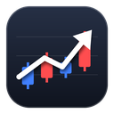

<p align="center">
  
</p>

<h1 align="center">StockInfo — 코스피 · 코스닥 주식 정보</h1>

<p align="center">Qt 6 위젯으로 만든 멀티플랫폼(Windows / macOS / Linux) 주식 시세 뷰어<br>
<b>버전 1.5.0</b> · <a href="https://github.com/Sung-Hwan-Kim/StockInfo/releases/latest">Windows 실행 파일 다운로드</a> · <a href="#변경-이력">변경 이력</a></p>

## 실행 화면

| 다크 모드 (기본) | 라이트 모드 |
|:---:|:---:|
|  |  |

<p align="center">
  <br>
  <sub>창을 넓히면 대비 금액, 거래량, 거래대금까지 표시</sub>
</p>

<p align="center">
  <br>
  <sub>상세 창 — 종목이나 지수를 더블클릭: 캔들(일/주/월봉), 이동평균, 볼린저밴드, 거래량, MACD(OSC), RSI, 스토캐스틱</sub>
</p>

<p align="center">
  <br>
  <sub>환경설정 창 — 갱신 시간, 글꼴 크기, 스킨, 트레이, 종목 검색/추가</sub>
</p>

## 다운로드

[Releases](https://github.com/Sung-Hwan-Kim/StockInfo/releases/latest)에서 `StockInfo-v<버전>-windows-x64.zip`을 내려받아
압축을 풀고 `StockInfo.exe`를 실행하면 됩니다. (Windows 10/11 64비트, 설치 필요 없음)

## 기능

- **코스피/코스닥 지수**를 크게 표시: 현재값, 전일 대비, 등락률, 시가/고가/저가, 장 상태, 거래대금
  - 창 크기에 맞춰 글자 크기가 자동으로 조절됩니다.
- **관심 종목 리스트**: 한 종목을 두 줄로 표시 (상승 빨강 / 하락 파랑)

  | 종목명 | 현재가 | 고가 | 저가 | 거래량 |
  |---|--:|--:|--:|--:|
  | 종목코드 | ▲ 대비  등락률% | 고가 등락률% | 저가 등락률% | 거래대금 |

  - 그날의 **고가·저가와 그 퍼센트**(전일 종가 대비)를 함께 보여줍니다.
  - 창 폭에 맞춰 자동 조절: 좁으면 거래량 열을 숨기고, 더 좁으면 현재가 아래 줄을 등락률만 표시합니다.
    마우스를 올리면 툴팁에 전체 정보(시가 포함)를 보여줍니다.
  - 종목이 많으면 스크롤바가 생깁니다.
  - 종목의 실제 시장(코스피/코스닥)을 자동으로 판별해서 알맞은 목록에 표시합니다.
- **종목 · 지수 상세 창** (종목이나 코스피 · 코스닥 지수 패널을 더블클릭, 또는 오른쪽 클릭 → [상세 보기])
  - 현재가 · 대비 · 등락률, 시가 / 고가 / 저가(등락률), 전일 종가, 거래량, 거래대금, 시가총액(종목), 52주 최고 / 최저
  - 지수 차트의 거래량은 천 주 단위로 표시됩니다.
  - 차트: 일봉 / 주봉 / 월봉 캔들, 이동평균선(5 · 20 · 60 · 120), 볼린저밴드(20, 2), 거래량,
    MACD(12, 26, 9: MACD선 · 시그널 · OSC 막대), RSI(14), 스토캐스틱 슬로우(12, 5, 5) — 지표마다 켜고 끄기
  - 마우스 휠로 확대 / 축소, 끌어서 이동, 더블클릭으로 처음 보기. 마우스를 올리면 그 봉의 값과 지표 값을 표시
  - 보이는 구간의 최고가 · 최저가 표시, 오른쪽 축에 현재가 꼬리표
  - 메인 창의 시세 갱신에 맞춰 상세 창의 시세와 오늘 봉도 실시간으로 바뀝니다.
  - 봉 주기 · 지표 선택 · 창 위치는 저장되어 다음에도 그대로 열립니다.
- **실시간 갱신 버튼**: 메뉴 막대 오른쪽의 [⟳ 실시간 갱신]을 누르면 바로 시세를 다시 받아옵니다. (F5와 같음)
  받는 동안 ⟳ 아이콘이 돌고, 다 받으면 버튼이 반짝입니다. 자동 갱신 카운트다운도 처음부터 다시 셉니다.
- **스킨**: 다크 모드(기본) / 라이트 모드
  - OS 테마와 상관없이 같은 모양으로 보이며, Windows에서는 제목 표시줄 색도 함께 바뀝니다.
  - [설정 → 스킨] 메뉴나 환경설정 창에서 바로 전환됩니다.
- **갱신 시간**을 초 단위로 설정 (1 ~ 3600초)
- **종목 추가**: 종목명 또는 코드로 검색 → 추가 / 삭제 / 순서 변경
- **창 위치·크기·최대화 상태 저장** → 다음 실행 때 그대로 복원
- 항상 위에 표시, 목록 글꼴 크기 설정
- **트레이 아이콘** (알림 영역)
  - 마우스를 올리면 코스피 · 코스닥 지수를 툴팁으로 표시
  - 클릭: 창 보이기 / 숨기기, 오른쪽 클릭: 새로고침 · 종목 관리 · 환경설정 · 스킨 · 항상 위 · 종료
  - 닫기(X) 버튼을 누르면 트레이로 숨기고 시세는 계속 갱신합니다. 끝내려면 [파일 → 종료] 또는 트레이 메뉴의 [종료].
  - 최소화할 때 트레이로 숨기기는 환경설정에서 켤 수 있습니다.
  - Windows 11은 새 아이콘을 숨겨진 아이콘 영역(^)에 넣습니다. 늘 보이게 하려면 아이콘을 작업 표시줄로 끌어다 놓거나
    [설정 → 개인 설정 → 작업 표시줄 → 기타 시스템 트레이 아이콘]에서 StockInfo를 켜세요.
- **중복 실행 방지**: 이미 실행 중일 때 다시 실행하면 새로 띄우지 않고 기존 창을 보여줍니다.
- **버전 정보** ([도움말 → 버전 정보], 또는 상태 표시줄 오른쪽의 `v1.3.0` 클릭)
  - 버전, 빌드 날짜, Qt · 컴파일러 · 운영체제, 설정 파일 위치, 홈페이지 링크
  - [버전 정보 복사] 버튼으로 문의/버그 신고에 붙여 넣기
  - Windows 실행 파일 속성(자세히)에도 버전이 기록됩니다.
- 지수 패널에서 마우스 오른쪽 버튼 → 상세 보기 / 네이버 금융에서 보기
- 종목 목록에서 마우스 오른쪽 버튼 → 상세 보기 / 네이버 금융에서 보기 / 삭제 / 종목 추가

## 단축키

| 키 | 동작 |
|---|---|
| F5 | 지금 새로고침 (= [⟳ 실시간 갱신] 버튼) |
| Ctrl+, | 환경설정 |
| Ctrl+N | 종목 추가/관리 |
| Ctrl+Shift+D | 다크 모드 |
| Ctrl+Shift+L | 라이트 모드 |
| Ctrl+T | 항상 위에 표시 |
| Ctrl+Q | 종료 |

## 설정 파일 (INI)

실행 파일과 같은 폴더의 `StockInfo.ini`에 저장됩니다.
그 폴더에 쓸 수 없으면(예: Program Files, macOS 앱 번들) 사용자 설정 폴더에 저장됩니다.
정확한 경로는 환경설정 창 아래쪽이나 [도움말 → 버전 정보]에서 볼 수 있습니다.

```ini
[Settings]
RefreshSeconds=5      ; 갱신 시간(초)
ListFontSize=11       ; 종목 목록 글꼴 크기(pt)
AlwaysOnTop=false
Skin=Dark             ; Dark(기본) 또는 Light
TrayIcon=true         ; 트레이 아이콘 표시
CloseToTray=true      ; 닫기(X) → 트레이로 숨기기
MinimizeToTray=false  ; 최소화 → 트레이로 숨기기
TrayNoticeShown=true  ; "트레이에서 실행 중" 안내를 이미 보여줬는지

[Window]              ; 창 위치/크기 (자동 저장)
X=100
Y=60
Width=680
Height=860
Maximized=false

[DetailWindow]        ; 종목 상세 창 (자동 저장)
Timeframe=day         ; day / week / month
MA=true               ; 이동평균
Bollinger=false
Volume=true
MACD=true
RSI=true
Stochastic=false
X=200
Y=100
Width=1000
Height=760
Maximized=false

[Stocks]
size=2
1\Code=005930
1\Name=삼성전자
1\Market=KOSPI
2\Code=247540
2\Name=에코프로비엠
2\Market=KOSDAQ
```

저장된 위치가 현재 연결된 모니터 밖에 있으면(모니터를 뺀 경우 등) 기본 위치에 표시합니다.

## 빌드

### Windows (Visual Studio 2019 + Qt 6.7.0)

```bat
build_vs2019.bat
```

- 결과물: `build\Release\StockInfo.exe` (빌드 후 `windeployqt`가 Qt DLL을 자동으로 복사하므로 바로 실행 가능)
- Visual Studio 2019에서 열기: `build\StockInfo.sln`
- Debug 빌드: `build_vs2019.bat Debug`
- Qt 경로가 다르면 `build_vs2019.bat`의 `QT_DIR`을 수정하세요.

### macOS / Linux

```sh
cmake -S . -B build -DCMAKE_PREFIX_PATH=<Qt 설치경로>/6.7.0/<macos|gcc_64>
cmake --build build
```

## 아이콘

| 파일 | 용도 |
|---|---|
| `resources/icons/StockInfo.ico` | Windows 실행 파일 아이콘 (`resources/StockInfo.rc.in`으로 내장, 버전 정보 포함) |
| `resources/icons/StockInfo.icns` | macOS 앱 번들 아이콘 |
| `resources/icons/icon_*.png` | 창 · 작업 표시줄 아이콘 (Qt 리소스로 내장) |

아이콘을 고치려면 `tools/make_icon.py`를 수정한 뒤 다시 생성합니다 (Pillow 필요).

```sh
python tools/make_icon.py
```

## 폴더 구조

```
src/            소스 코드 (MainWindow, IndexPanel, StockListWidget, SettingsDialog, Skin,
                StockDetailDialog, ChartWidget, ChartData(보조지표 계산) …)
resources/      아이콘, Windows 리소스(.rc) 템플릿
tools/          아이콘 생성 스크립트
docs/           README 스크린샷
```

## 변경 이력

버전은 `CMakeLists.txt`의 `project(StockInfo VERSION x.y.z)` 한 곳에서 관리합니다.
(버전 정보 창, 상태 표시줄, Windows 실행 파일 속성, macOS 번들에 자동 반영)

### 1.5.0
- **지수 상세 창**: 코스피 · 코스닥 지수 패널을 더블클릭하면 지수 차트와 시세 요약 (실시간 갱신)
- 지수 패널 오른쪽 클릭 메뉴: 상세 보기 / 네이버 금융에서 보기
- 차트 가격 축 눈금을 간격에 맞게 표시 (예: 9,000.00 → 9,000)

### 1.4.0
- **종목 상세 창**: 종목을 더블클릭하면 시세 요약과 차트
  (일/주/월봉 캔들, 이동평균, 볼린저밴드, 거래량, MACD · OSC, RSI, 스토캐스틱) 표시, 실시간 갱신
- **[⟳ 실시간 갱신] 버튼**: 메뉴 막대 오른쪽, 누를 때마다 즉시 갱신

### 1.3.0
- **트레이 아이콘**: 지수 툴팁, 클릭으로 창 보이기/숨기기, 오른쪽 클릭 메뉴
- 닫기(X) → 트레이로 숨기기 (기본 켜짐), 최소화 → 트레이로 숨기기 (기본 꺼짐) 설정
- 중복 실행 방지: 다시 실행하면 기존 창을 띄움
- README에 다운로드(Releases) 안내 추가

### 1.2.0
- 종목 리스트에 그날의 **고가 · 저가와 등락률**(전일 종가 대비) 표시
- 종목을 두 줄로 표시 (종목코드, 대비 · 등락률, 거래대금을 아래 줄에)
- 창 폭에 따라 거래량 열 / 대비 금액을 자동으로 숨김
- **버전 정보** 창 추가, 상태 표시줄에 버전 표시, 도움말에 홈페이지 링크

### 1.1.0
- **다크 / 라이트 스킨** (기본: 다크), Windows 제목 표시줄 색 연동
- 실행 파일 · 창 아이콘 (Windows .ico, macOS .icns)
- README 실행 화면 스크린샷

### 1.0.0
- 첫 버전: 코스피 · 코스닥 지수, 관심 종목 리스트, 갱신 주기 설정, 종목 검색/추가,
  INI 설정 저장, 창 위치 · 크기 복원

## 데이터 출처

네이버 금융의 공개 시세 API(비공식)를 사용합니다. 실시간 시세는 polling API, 차트(일/주/월봉)는 fchart API에서 받습니다.
API가 바뀌면 동작하지 않을 수 있고, 표시되는 시세는 참고용입니다.
