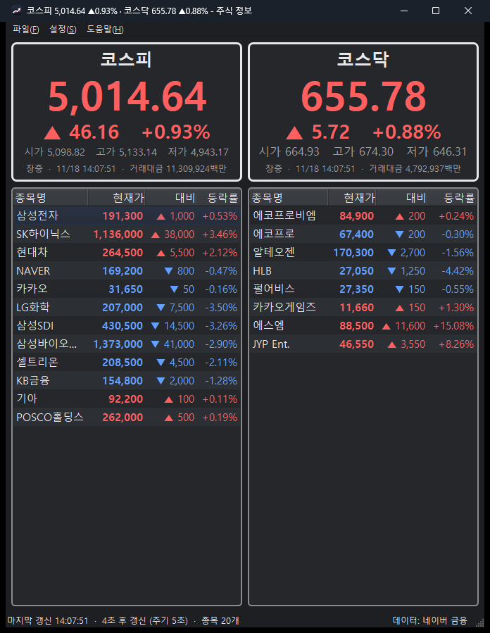
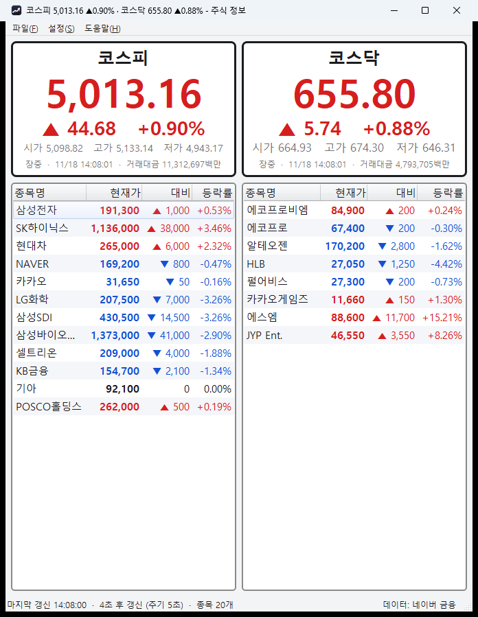
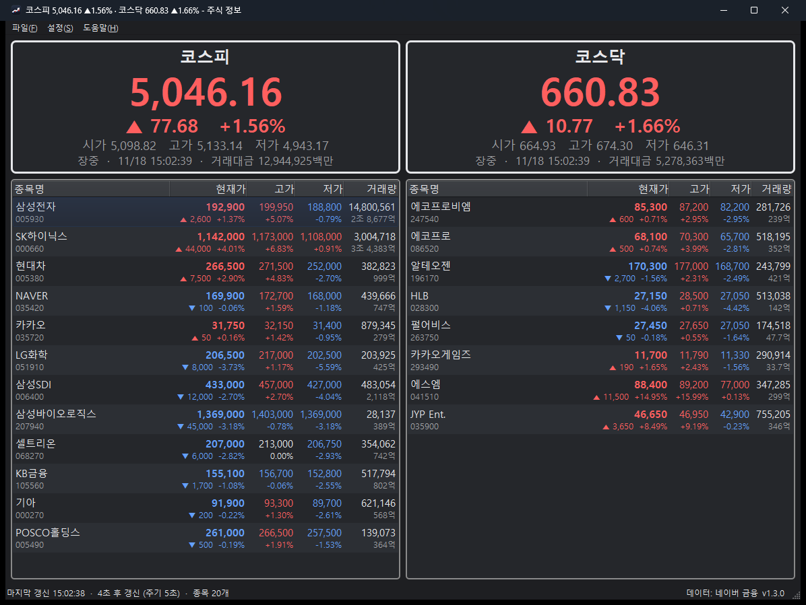
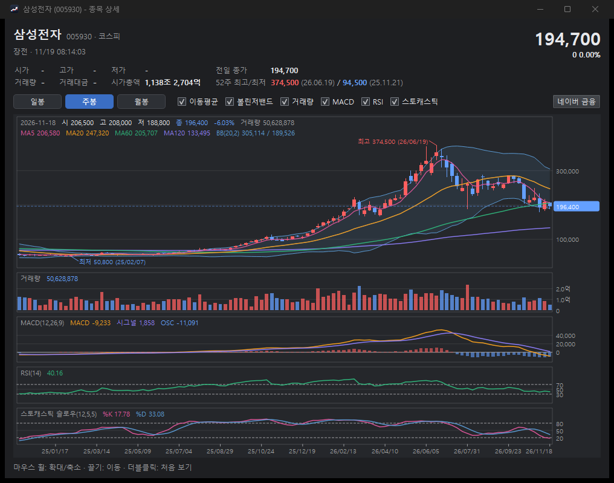
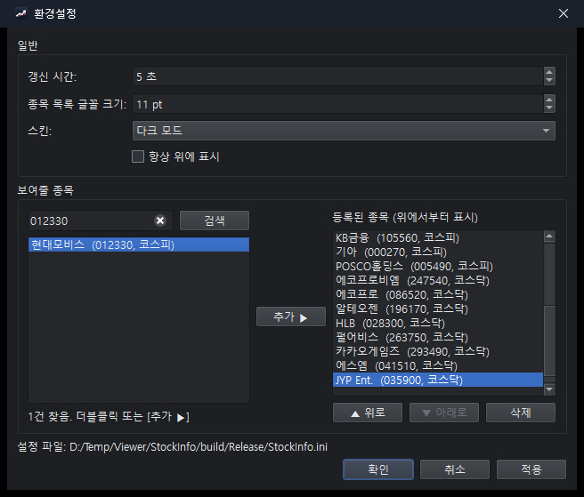
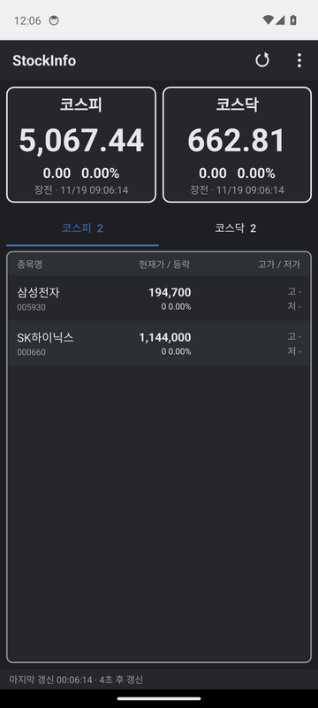
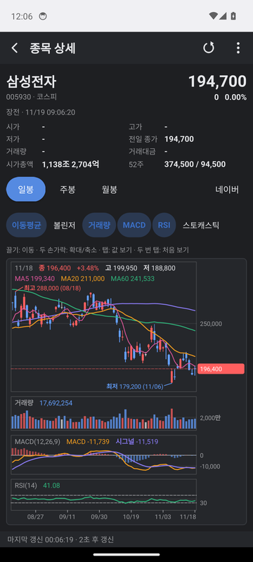
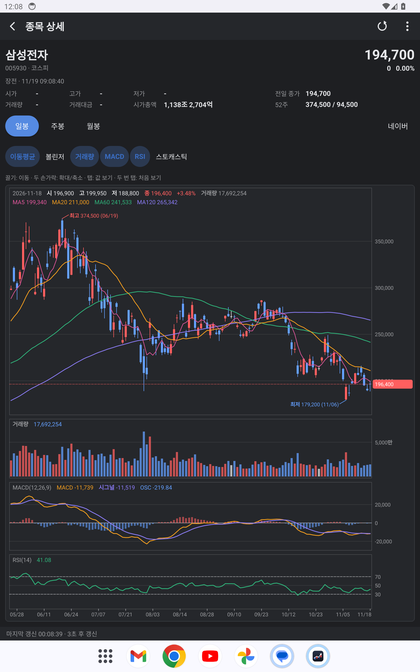
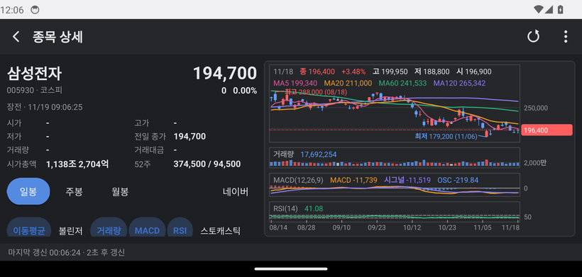
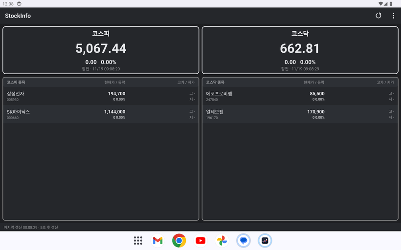

<p align="center">
  
</p>

<h1 align="center">StockInfo — 코스피 · 코스닥 주식 정보</h1>

<p align="center">Qt 6로 만든 주식 시세 뷰어 — PC(Windows / macOS / Linux) + <b>안드로이드(폰 · 태블릿)</b><br>
<b>버전 1.6.0</b> · <a href="https://github.com/Sung-Hwan-Kim/StockInfo/releases/latest">Windows 실행 파일 다운로드</a> · <a href="#변경-이력">변경 이력</a></p>

## 실행 화면

| 다크 모드 (기본) | 라이트 모드 |
|:---:|:---:|
|  |  |

<p align="center">
  <br>
  <sub>창을 넓히면 대비 금액, 거래량, 거래대금까지 표시</sub>
</p>

<p align="center">
  <br>
  <sub>상세 창 — 종목이나 지수를 더블클릭: 캔들(일/주/월봉), 이동평균, 볼린저밴드, 거래량, MACD(OSC), RSI, 스토캐스틱</sub>
</p>

<p align="center">
  <br>
  <sub>환경설정 창 — 갱신 시간, 글꼴 크기, 스킨, 트레이, 종목 검색/추가</sub>
</p>

## 다운로드

[Releases](https://github.com/Sung-Hwan-Kim/StockInfo/releases/latest)에서 내려받습니다.

- **Windows**: `StockInfo-v<버전>-windows-x64.zip` — 압축을 풀고 `StockInfo.exe` 실행 (Windows 10/11 64비트, 설치 필요 없음)
- **안드로이드**: `StockInfo-v<버전>-android.apk` — 폰/태블릿에서 내려받아 설치 (Android 9 이상)
  - 처음 설치할 때 "출처를 알 수 없는 앱 설치"를 허용해야 합니다. (Play 스토어 앱이 아님)

## 안드로이드 앱 (폰 · 태블릿)

<table>
  <tr>
    <th>폰 · 세로</th>
    <th>폰 · 세로 (상세)</th>
    <th>태블릿 · 세로 (상세)</th>
  </tr>
  <tr>
    <td></td>
    <td></td>
    <td></td>
  </tr>
</table>

<p align="center">
  <br>
  <sub>폰 · 가로 — 왼쪽 시세 요약, 오른쪽 차트</sub>
</p>

<p align="center">
  <br>
  <sub>태블릿 · 가로 — PC처럼 지수 카드 + 좌우 2단 목록</sub>
</p>

<sub>※ 스크린샷은 에뮬레이터(Pixel 7, Pixel Tablet)에서 장 시작 전에 찍어 등락이 0으로 보입니다.</sub>

PC 버전과 같은 시세 · 차트 코드를 쓰고, 화면은 터치에 맞게 새로 구성했습니다. **가로 · 세로 모드를 모두 지원**합니다.

| 화면 | 폰 세로 | 폰 가로 | 태블릿 (세로 · 가로) |
|---|---|---|---|
| 첫 화면 | 지수 카드 + [코스피 \| 코스닥] 탭 목록 | 왼쪽 지수 카드 + 오른쪽 탭 목록 | 지수 카드 + 좌우 2단 목록 (PC와 같은 배치) |
| 상세 화면 | 위 시세 요약 + 아래 차트 | 왼쪽 시세 요약 + 오른쪽 큰 차트 | 위 시세 요약 + 아래 큰 차트 |

- 종목 · 지수를 **탭**하면 상세 화면 (시세 요약 + 일/주/월봉 차트, 이동평균, 볼린저밴드, 거래량, MACD · OSC, RSI, 스토캐스틱)
- 차트: **끌기** 이동, **두 손가락** 확대 / 축소, **탭** 값 보기, **두 번 탭** 처음 보기
- 종목 목록: **아래로 당겨서 새로고침**, **길게 누르면** 메뉴 (상세 보기 / 네이버 금융 / 삭제)
- 오른쪽 위 ⟳ 버튼: 즉시 갱신, ⋮ 메뉴: 종목 추가/관리, 다크/라이트 모드, 버전 정보
- 앱이 백그라운드로 가면 갱신을 멈추고, 다시 열면 바로 갱신합니다 (배터리 절약)
- 설정과 종목 목록은 앱 전용 설정 파일(INI)에 저장됩니다.

## 기능

- **코스피/코스닥 지수**를 크게 표시: 현재값, 전일 대비, 등락률, 시가/고가/저가, 장 상태, 거래대금
  - 창 크기에 맞춰 글자 크기가 자동으로 조절됩니다.
- **관심 종목 리스트**: 한 종목을 두 줄로 표시 (상승 빨강 / 하락 파랑)

  | 종목명 | 현재가 | 고가 | 저가 | 거래량 |
  |---|--:|--:|--:|--:|
  | 종목코드 | ▲ 대비  등락률% | 고가 등락률% | 저가 등락률% | 거래대금 |

  - 그날의 **고가·저가와 그 퍼센트**(전일 종가 대비)를 함께 보여줍니다.
  - 창 폭에 맞춰 자동 조절: 좁으면 거래량 열을 숨기고, 더 좁으면 현재가 아래 줄을 등락률만 표시합니다.
    마우스를 올리면 툴팁에 전체 정보(시가 포함)를 보여줍니다.
  - 종목이 많으면 스크롤바가 생깁니다.
  - 종목의 실제 시장(코스피/코스닥)을 자동으로 판별해서 알맞은 목록에 표시합니다.
- **종목 · 지수 상세 창** (종목이나 코스피 · 코스닥 지수 패널을 더블클릭, 또는 오른쪽 클릭 → [상세 보기])
  - 현재가 · 대비 · 등락률, 시가 / 고가 / 저가(등락률), 전일 종가, 거래량, 거래대금, 시가총액(종목), 52주 최고 / 최저
  - 지수 차트의 거래량은 천 주 단위로 표시됩니다.
  - 차트: 일봉 / 주봉 / 월봉 캔들, 이동평균선(5 · 20 · 60 · 120), 볼린저밴드(20, 2), 거래량,
    MACD(12, 26, 9: MACD선 · 시그널 · OSC 막대), RSI(14), 스토캐스틱 슬로우(12, 5, 5) — 지표마다 켜고 끄기
  - 마우스 휠로 확대 / 축소, 끌어서 이동, 더블클릭으로 처음 보기. 마우스를 올리면 그 봉의 값과 지표 값을 표시
  - 보이는 구간의 최고가 · 최저가 표시, 오른쪽 축에 현재가 꼬리표
  - 메인 창의 시세 갱신에 맞춰 상세 창의 시세와 오늘 봉도 실시간으로 바뀝니다.
  - 봉 주기 · 지표 선택 · 창 위치는 저장되어 다음에도 그대로 열립니다.
- **실시간 갱신 버튼**: 메뉴 막대 오른쪽의 [⟳ 실시간 갱신]을 누르면 바로 시세를 다시 받아옵니다. (F5와 같음)
  받는 동안 ⟳ 아이콘이 돌고, 다 받으면 버튼이 반짝입니다. 자동 갱신 카운트다운도 처음부터 다시 셉니다.
- **스킨**: 다크 모드(기본) / 라이트 모드
  - OS 테마와 상관없이 같은 모양으로 보이며, Windows에서는 제목 표시줄 색도 함께 바뀝니다.
  - [설정 → 스킨] 메뉴나 환경설정 창에서 바로 전환됩니다.
- **갱신 시간**을 초 단위로 설정 (1 ~ 3600초)
- **종목 추가**: 종목명 또는 코드로 검색 → 추가 / 삭제 / 순서 변경
- **창 위치·크기·최대화 상태 저장** → 다음 실행 때 그대로 복원
- 항상 위에 표시, 목록 글꼴 크기 설정
- **트레이 아이콘** (알림 영역)
  - 마우스를 올리면 코스피 · 코스닥 지수를 툴팁으로 표시
  - 클릭: 창 보이기 / 숨기기, 오른쪽 클릭: 새로고침 · 종목 관리 · 환경설정 · 스킨 · 항상 위 · 종료
  - 닫기(X) 버튼을 누르면 트레이로 숨기고 시세는 계속 갱신합니다. 끝내려면 [파일 → 종료] 또는 트레이 메뉴의 [종료].
  - 최소화할 때 트레이로 숨기기는 환경설정에서 켤 수 있습니다.
  - Windows 11은 새 아이콘을 숨겨진 아이콘 영역(^)에 넣습니다. 늘 보이게 하려면 아이콘을 작업 표시줄로 끌어다 놓거나
    [설정 → 개인 설정 → 작업 표시줄 → 기타 시스템 트레이 아이콘]에서 StockInfo를 켜세요.
- **중복 실행 방지**: 이미 실행 중일 때 다시 실행하면 새로 띄우지 않고 기존 창을 보여줍니다.
- **버전 정보** ([도움말 → 버전 정보], 또는 상태 표시줄 오른쪽의 `v1.3.0` 클릭)
  - 버전, 빌드 날짜, Qt · 컴파일러 · 운영체제, 설정 파일 위치, 홈페이지 링크
  - [버전 정보 복사] 버튼으로 문의/버그 신고에 붙여 넣기
  - Windows 실행 파일 속성(자세히)에도 버전이 기록됩니다.
- 지수 패널에서 마우스 오른쪽 버튼 → 상세 보기 / 네이버 금융에서 보기
- 종목 목록에서 마우스 오른쪽 버튼 → 상세 보기 / 네이버 금융에서 보기 / 삭제 / 종목 추가

## 단축키

| 키 | 동작 |
|---|---|
| F5 | 지금 새로고침 (= [⟳ 실시간 갱신] 버튼) |
| Ctrl+, | 환경설정 |
| Ctrl+N | 종목 추가/관리 |
| Ctrl+Shift+D | 다크 모드 |
| Ctrl+Shift+L | 라이트 모드 |
| Ctrl+T | 항상 위에 표시 |
| Ctrl+Q | 종료 |

## 설정 파일 (INI)

실행 파일과 같은 폴더의 `StockInfo.ini`에 저장됩니다.
그 폴더에 쓸 수 없으면(예: Program Files, macOS 앱 번들) 사용자 설정 폴더에 저장됩니다.
정확한 경로는 환경설정 창 아래쪽이나 [도움말 → 버전 정보]에서 볼 수 있습니다.

```ini
[Settings]
RefreshSeconds=5      ; 갱신 시간(초)
ListFontSize=11       ; 종목 목록 글꼴 크기(pt)
AlwaysOnTop=false
Skin=Dark             ; Dark(기본) 또는 Light
TrayIcon=true         ; 트레이 아이콘 표시
CloseToTray=true      ; 닫기(X) → 트레이로 숨기기
MinimizeToTray=false  ; 최소화 → 트레이로 숨기기
TrayNoticeShown=true  ; "트레이에서 실행 중" 안내를 이미 보여줬는지

[Window]              ; 창 위치/크기 (자동 저장)
X=100
Y=60
Width=680
Height=860
Maximized=false

[DetailWindow]        ; 종목 상세 창 (자동 저장)
Timeframe=day         ; day / week / month
MA=true               ; 이동평균
Bollinger=false
Volume=true
MACD=true
RSI=true
Stochastic=false
X=200
Y=100
Width=1000
Height=760
Maximized=false

[Stocks]
size=2
1\Code=005930
1\Name=삼성전자
1\Market=KOSPI
2\Code=247540
2\Name=에코프로비엠
2\Market=KOSDAQ
```

저장된 위치가 현재 연결된 모니터 밖에 있으면(모니터를 뺀 경우 등) 기본 위치에 표시합니다.

## 빌드

### Windows (Visual Studio 2019 + Qt 6.7.0)

```bat
build_vs2019.bat
```

- 결과물: `build\Release\StockInfo.exe` (빌드 후 `windeployqt`가 Qt DLL을 자동으로 복사하므로 바로 실행 가능)
- Visual Studio 2019에서 열기: `build\StockInfo.sln`
- Debug 빌드: `build_vs2019.bat Debug`
- Qt 경로가 다르면 `build_vs2019.bat`의 `QT_DIR`을 수정하세요.

### 안드로이드 APK (Windows에서 빌드)

안드로이드 앱은 Windows PC에서 빌드합니다. 아래 순서대로 한 번만 준비하면 이후에는 `build_android.bat`만 실행하면 됩니다.

#### 1. 필요한 도구

| 도구 | 버전 | 설치 위치 (기본값) | 용도 |
|---|---|---|---|
| Qt for Android | 6.7.0 — `Android ARM64-v8a`, `Android x86_64` | `C:\Qt\Qt6.7.0\6.7.0\android_*` | 안드로이드용 Qt 라이브러리 |
| Qt (PC용) | 6.7.0 — `MSVC 2019 64-bit` | `C:\Qt\Qt6.7.0\6.7.0\msvc2019_64` | 빌드할 때 쓰는 도구(moc, qmlcachegen …) |
| JDK | 17 (Microsoft Build of OpenJDK) | `C:\Program Files\Microsoft\jdk-17.*` | Gradle, APK 서명 |
| Android SDK Command-line Tools | 최신 | `C:\Android\Sdk\cmdline-tools\latest` | `sdkmanager`, `avdmanager` |
| Android SDK Platform | 34 (Android 14) | `C:\Android\Sdk\platforms\android-34` | 컴파일 대상 |
| Android SDK Build-Tools | 34.0.0 | `C:\Android\Sdk\build-tools\34.0.0` | `zipalign`, `apksigner` |
| Android NDK | r26b (`26.1.10909125`) | `C:\Android\Sdk\ndk\26.1.10909125` | C++ 컴파일 (Qt 6.7 권장 버전) |
| Android SDK Platform-Tools | 최신 | `C:\Android\Sdk\platform-tools` | `adb` (기기 설치·디버깅) |
| OpenSSL 3 for Android | KDAB android_openssl | `C:\Android\android_openssl\ssl_3\<ABI>` | HTTPS 시세 조회 (Qt에 포함되어 있지 않음) |
| (선택) Android Emulator + 시스템 이미지 | Android 14 `google_apis` `x86_64` | `C:\Android\Sdk\emulator`, `system-images` | PC에서 폰·태블릿 테스트 |
| CMake | 3.21 이상 | | |
| Ninja | Visual Studio 2019에 포함된 것 사용 | `...\Common7\IDE\CommonExtensions\Microsoft\CMake\Ninja` | |

필요한 디스크 공간: 약 3GB (에뮬레이터까지 설치하면 약 5GB). 처음 APK를 빌드할 때 Gradle이 약 300MB를 더 내려받습니다.

#### 2. Qt for Android 설치

1. Qt 설치 폴더의 `MaintenanceTool.exe`를 실행합니다. (예: `C:\Qt\Qt6.7.0\MaintenanceTool.exe`)
2. [구성 요소 추가 또는 제거] → `Qt 6.7.0` 아래에서 다음을 선택합니다.
   - `MSVC 2019 64-bit` (이미 있으면 그대로)
   - `Android ARM64-v8a` — 실제 폰·태블릿용
   - `Android x86_64` — 에뮬레이터용
3. 설치가 끝나면 `C:\Qt\Qt6.7.0\6.7.0\android_arm64_v8a\bin\qt-cmake.bat`이 있는지 확인합니다.

#### 3. JDK 17 설치

```bat
winget install Microsoft.OpenJDK.17
```

winget이 없으면 <https://learn.microsoft.com/java/openjdk/download>에서 **OpenJDK 17 Windows x64 MSI**를 받아 설치합니다.
(JDK 21 이상은 Qt 6.7의 Gradle 버전과 맞지 않을 수 있으니 17을 쓰세요.)

#### 4-A. Android SDK · NDK · OpenSSL 자동 설치 (권장)

```bat
powershell -ExecutionPolicy Bypass -File tools\install_android_sdk.ps1
```

이 스크립트가 하는 일:

1. Google 공식 저장소에서 명령줄 도구를 내려받아 `C:\Android\Sdk\cmdline-tools\latest`에 풉니다.
   (<https://dl.google.com/android/repository/commandlinetools-win-13114758_latest.zip>)
2. **Android SDK 라이선스에 동의**합니다. (`sdkmanager --licenses`에 `y`를 입력하는 것과 같습니다. 실행 전에 라이선스 내용을 확인하려면 아래 4-B의 5번처럼 직접 실행하세요.)
3. `platform-tools`, `platforms;android-34`, `build-tools;34.0.0`, `ndk;26.1.10909125`, `emulator`, `system-images;android-34;google_apis;x86_64`를 설치합니다.
4. KDAB android_openssl(<https://github.com/KDAB/android_openssl>)에서 OpenSSL 3(`libcrypto_3.so`, `libssl_3.so`)을 ABI별로 내려받아 `C:\Android\android_openssl`에 둡니다.
5. 설치된 폴더가 실제로 있는지 확인합니다.

옵션:

| 옵션 | 설명 |
|---|---|
| `-SdkRoot D:\Android\Sdk` | 다른 폴더에 설치 (경로에 공백 없이). OpenSSL은 그 상위 폴더의 `android_openssl`에 설치 |
| `-NoEmulator` | 에뮬레이터와 시스템 이미지는 빼고 빌드 도구만 설치 (약 2GB 절약) |
| `-JavaHome "C:\...\jdk-17..."` | JDK 위치를 직접 지정 |

#### 4-B. 직접 설치하는 방법

자동 설치 대신 직접 설치하려면 둘 중 하나를 고르세요.

**방법 1: Android Studio의 SDK Manager**

1. <https://developer.android.com/studio>에서 Android Studio를 설치합니다.
2. [More Actions] → [SDK Manager]를 엽니다.
   - **SDK Platforms** 탭: `Android 14.0 ("UpsideDownCake") / API 34`
   - **SDK Tools** 탭 (오른쪽 아래 `Show Package Details` 체크):
     - `Android SDK Build-Tools` → `34.0.0`
     - `NDK (Side by side)` → `26.1.10909125`
     - `Android SDK Command-line Tools (latest)`
     - `Android SDK Platform-Tools`
     - (선택) `Android Emulator`
3. SDK 위치(기본 `%LOCALAPPDATA%\Android\Sdk`)를 기억해 두고, 빌드 전에 `ANDROID_SDK_ROOT` 환경 변수로 지정합니다.

**방법 2: 명령줄 도구만 사용**

1. <https://developer.android.com/studio#command-line-tools-only>에서 **Windows용 Command line tools**(`commandlinetools-win-*_latest.zip`)를 받습니다.
2. `C:\Android\Sdk\cmdline-tools\` 아래에 압축을 풀고, 풀린 `cmdline-tools` 폴더 이름을 **`latest`**로 바꿉니다.
   최종 경로가 `C:\Android\Sdk\cmdline-tools\latest\bin\sdkmanager.bat`이 되어야 합니다.
3. 명령 프롬프트(cmd)를 열고 JDK 위치를 지정합니다.
   ```bat
   set JAVA_HOME=C:\Program Files\Microsoft\jdk-17.0.21.102-hotspot
   cd /d C:\Android\Sdk\cmdline-tools\latest\bin
   ```
4. 라이선스를 읽고 동의합니다. (항목마다 `y` 입력)
   ```bat
   sdkmanager --sdk_root=C:\Android\Sdk --licenses
   ```
5. 패키지를 설치합니다.
   ```bat
   sdkmanager --sdk_root=C:\Android\Sdk "platform-tools" "platforms;android-34" "build-tools;34.0.0" "ndk;26.1.10909125"
   ```
   에뮬레이터도 쓰려면:
   ```bat
   sdkmanager --sdk_root=C:\Android\Sdk "emulator" "system-images;android-34;google_apis;x86_64"
   ```
6. OpenSSL 3을 받습니다. <https://github.com/KDAB/android_openssl>의 `ssl_3/arm64-v8a`, `ssl_3/x86_64` 폴더에서
   `libcrypto_3.so`, `libssl_3.so`를 받아 같은 구조로 `C:\Android\android_openssl\ssl_3\<ABI>\`에 둡니다.
   (다른 위치에 두었다면 CMake 옵션 `-DSTOCKINFO_ANDROID_OPENSSL=<폴더>`로 지정)

#### 5. 경로가 다를 때

`build_android.bat`은 아래 기본값을 씁니다. 다르면 실행 전에 환경 변수를 지정하거나 배치 파일 맨 위의 값을 고치세요.

| 항목 | 기본값 | 바꾸는 방법 |
|---|---|---|
| Android SDK | `C:\Android\Sdk` | `set ANDROID_SDK_ROOT=D:\Android\Sdk` |
| JDK | `C:\Program Files\Microsoft\jdk-17*` 자동 검색 | `set JAVA_HOME=...` |
| Qt | `C:\Qt\Qt6.7.0\6.7.0` | 배치 파일의 `QT_ROOT` |
| Ninja | Visual Studio 2019에 포함된 ninja | 배치 파일의 `NINJA` |

#### 6. APK 빌드

```bat
build_android.bat
```

- 결과물: **`build-android\StockInfo-android.apk`** (서명됨)
- 폰·태블릿용(arm64-v8a)과 에뮬레이터용(x86_64)이 한 APK에 들어갑니다.
- **서명**: 기본은 안드로이드 표준 디버그 키(`%USERPROFILE%\.android\debug.keystore`, 없으면 자동 생성)로 서명합니다.
  직접 만든 배포용 키를 쓰려면 빌드 전에 지정하세요. (같은 앱을 업데이트하려면 항상 같은 키로 서명해야 합니다.)
  ```bat
  set STOCKINFO_KEYSTORE=C:\keys\stockinfo.jks
  set STOCKINFO_KEY_ALIAS=stockinfo
  set STOCKINFO_KEYSTORE_PASS=비밀번호
  build_android.bat
  ```

#### 7. 폰 · 태블릿에 설치

- **APK 파일로 설치**: APK를 폰으로 옮긴 뒤(메신저, USB, 클라우드 등) 파일을 열어 설치합니다.
  처음에는 "출처를 알 수 없는 앱 설치" 허용이 필요합니다.
- **USB로 설치**: 폰의 [설정 → 휴대전화 정보 → 빌드 번호]를 7번 눌러 개발자 옵션을 켜고, [개발자 옵션 → USB 디버깅]을 켠 뒤
  ```bat
  C:\Android\Sdk\platform-tools\adb install -r build-android\StockInfo-android.apk
  ```

#### 8. 에뮬레이터로 테스트 (선택)

```bat
set ANDROID_SDK_ROOT=C:\Android\Sdk
rem 폰 / 태블릿 가상 기기 만들기 (한 번만)
C:\Android\Sdk\cmdline-tools\latest\bin\avdmanager create avd -n StockInfo_Phone  -k "system-images;android-34;google_apis;x86_64" -d pixel_7
C:\Android\Sdk\cmdline-tools\latest\bin\avdmanager create avd -n StockInfo_Tablet -k "system-images;android-34;google_apis;x86_64" -d pixel_tablet
rem 실행 후 설치
C:\Android\Sdk\emulator\emulator -avd StockInfo_Phone
C:\Android\Sdk\platform-tools\adb install -r build-android\StockInfo-android.apk
```

에뮬레이터 화면에서 회전 버튼을 누르면 가로 · 세로 배치를 확인할 수 있습니다.
(하드웨어 가속을 쓰려면 Windows의 "Windows 하이퍼바이저 플랫폼" 기능이 켜져 있어야 합니다. `emulator -accel-check`로 확인)

#### 9. 문제 해결

| 증상 | 해결 |
|---|---|
| `sdkmanager`가 패키지를 설치하지 않고 "license is not accepted" | `sdkmanager --sdk_root=C:\Android\Sdk --licenses`를 직접 실행해서 모두 `y` |
| Gradle에서 `Unable to establish loopback connection` | JDK 17이 Windows 임시 폴더에 소켓을 못 만드는 문제. `build_android.bat`이 `JAVA_TOOL_OPTIONS=-Djdk.net.unixdomain.tmpdir=...`로 자동 처리 |
| 앱에서 "TLS initialization failed" | OpenSSL 3이 APK에 없음. `C:\Android\android_openssl\ssl_3\<ABI>\libssl_3.so`가 있는지 확인 후 다시 빌드 |
| `[오류] Android NDK를 찾을 수 없습니다` | NDK 버전 폴더가 `26.1.10909125`인지 확인 |
| 첫 빌드가 오래 걸림 | Gradle 8.3과 안드로이드 빌드 플러그인을 처음 한 번 내려받기 때문 (인터넷 필요) |
| `QML import could not be resolved: QtQuick.Controls.Windows` 경고 | 안드로이드에서 쓰지 않는 스타일이라 무시해도 됨 |

모바일 화면은 PC에서도 미리 볼 수 있습니다 (`-DSTOCKINFO_BUILD_MOBILE=ON -DSTOCKINFO_BUILD_DESKTOP=OFF`로 빌드하면 `StockInfoMobile.exe`).

### macOS / Linux

```sh
cmake -S . -B build -DCMAKE_PREFIX_PATH=<Qt 설치경로>/6.7.0/<macos|gcc_64>
cmake --build build
```

## 아이콘

| 파일 | 용도 |
|---|---|
| `resources/icons/StockInfo.ico` | Windows 실행 파일 아이콘 (`resources/StockInfo.rc.in`으로 내장, 버전 정보 포함) |
| `resources/icons/StockInfo.icns` | macOS 앱 번들 아이콘 |
| `resources/icons/icon_*.png` | 창 · 작업 표시줄 아이콘 (Qt 리소스로 내장) |

아이콘을 고치려면 `tools/make_icon.py`를 수정한 뒤 다시 생성합니다 (Pillow 필요).

```sh
python tools/make_icon.py
```

## 폴더 구조

```
src/            PC 앱 + 공용 코드
                  공용: StockService(시세), AppSettings(INI), ChartData(보조지표), ChartCanvas(차트 그리기), SkinPalette
                  PC:   MainWindow, IndexPanel, StockListWidget, StockDetailDialog, ChartWidget, SettingsDialog …
mobile/         안드로이드 앱 (Qt Quick): AppController, QuoteListModel, ChartItem, qml/*.qml, android/(매니페스트·아이콘)
resources/      아이콘, Windows 리소스(.rc) 템플릿
tools/          아이콘 생성(make_icon.py), 안드로이드 빌드 도구 설치(install_android_sdk.ps1)
docs/           README 스크린샷
```

## 변경 이력

버전은 `CMakeLists.txt`의 `project(StockInfo VERSION x.y.z)` 한 곳에서 관리합니다.
(버전 정보 창, 상태 표시줄, Windows 실행 파일 속성, macOS 번들에 자동 반영)

### 1.6.0
- **안드로이드 앱 (폰 · 태블릿)**: 지수 카드, 종목 목록, 종목/지수 상세 + 차트, 종목 검색/추가/삭제/순서, 다크/라이트
  - 가로 · 세로 모드 모두 지원 (폰 가로는 좌우 배치, 태블릿은 PC처럼 2단)
  - 차트 터치 조작: 끌기 이동, 두 손가락 확대/축소, 탭 값 보기
- 차트 그리기 코드를 PC/모바일 공용(`ChartCanvas`)으로 분리
- 안드로이드 빌드 스크립트 (`build_android.bat`, `tools/install_android_sdk.ps1`)

### 1.5.0
- **지수 상세 창**: 코스피 · 코스닥 지수 패널을 더블클릭하면 지수 차트와 시세 요약 (실시간 갱신)
- 지수 패널 오른쪽 클릭 메뉴: 상세 보기 / 네이버 금융에서 보기
- 차트 가격 축 눈금을 간격에 맞게 표시 (예: 9,000.00 → 9,000)

### 1.4.0
- **종목 상세 창**: 종목을 더블클릭하면 시세 요약과 차트
  (일/주/월봉 캔들, 이동평균, 볼린저밴드, 거래량, MACD · OSC, RSI, 스토캐스틱) 표시, 실시간 갱신
- **[⟳ 실시간 갱신] 버튼**: 메뉴 막대 오른쪽, 누를 때마다 즉시 갱신

### 1.3.0
- **트레이 아이콘**: 지수 툴팁, 클릭으로 창 보이기/숨기기, 오른쪽 클릭 메뉴
- 닫기(X) → 트레이로 숨기기 (기본 켜짐), 최소화 → 트레이로 숨기기 (기본 꺼짐) 설정
- 중복 실행 방지: 다시 실행하면 기존 창을 띄움
- README에 다운로드(Releases) 안내 추가

### 1.2.0
- 종목 리스트에 그날의 **고가 · 저가와 등락률**(전일 종가 대비) 표시
- 종목을 두 줄로 표시 (종목코드, 대비 · 등락률, 거래대금을 아래 줄에)
- 창 폭에 따라 거래량 열 / 대비 금액을 자동으로 숨김
- **버전 정보** 창 추가, 상태 표시줄에 버전 표시, 도움말에 홈페이지 링크

### 1.1.0
- **다크 / 라이트 스킨** (기본: 다크), Windows 제목 표시줄 색 연동
- 실행 파일 · 창 아이콘 (Windows .ico, macOS .icns)
- README 실행 화면 스크린샷

### 1.0.0
- 첫 버전: 코스피 · 코스닥 지수, 관심 종목 리스트, 갱신 주기 설정, 종목 검색/추가,
  INI 설정 저장, 창 위치 · 크기 복원

## 데이터 출처

네이버 금융의 공개 시세 API(비공식)를 사용합니다. 실시간 시세는 polling API, 차트(일/주/월봉)는 fchart API에서 받습니다.
API가 바뀌면 동작하지 않을 수 있고, 표시되는 시세는 참고용입니다.
